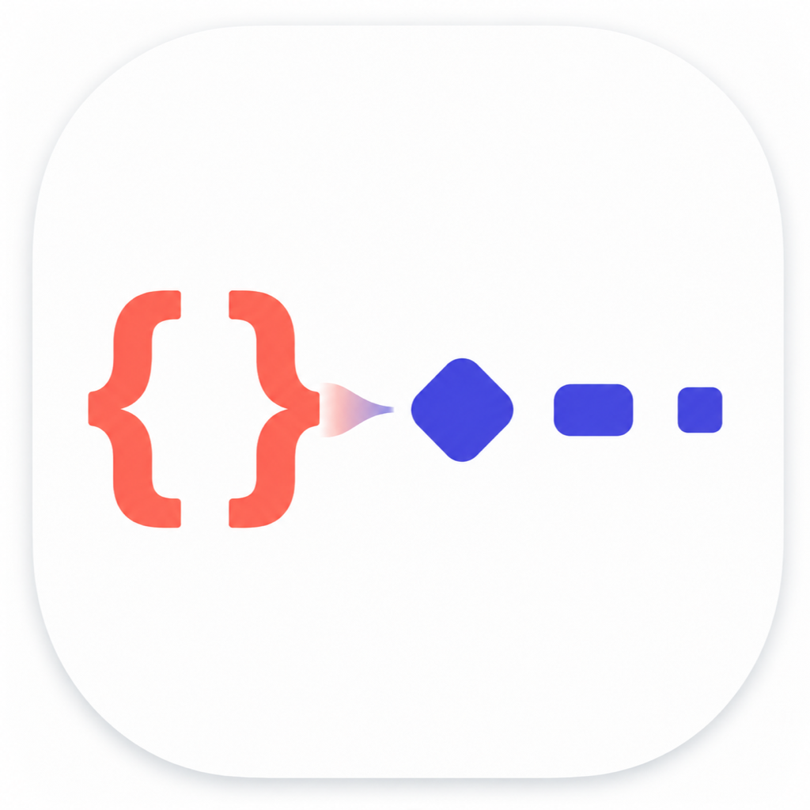
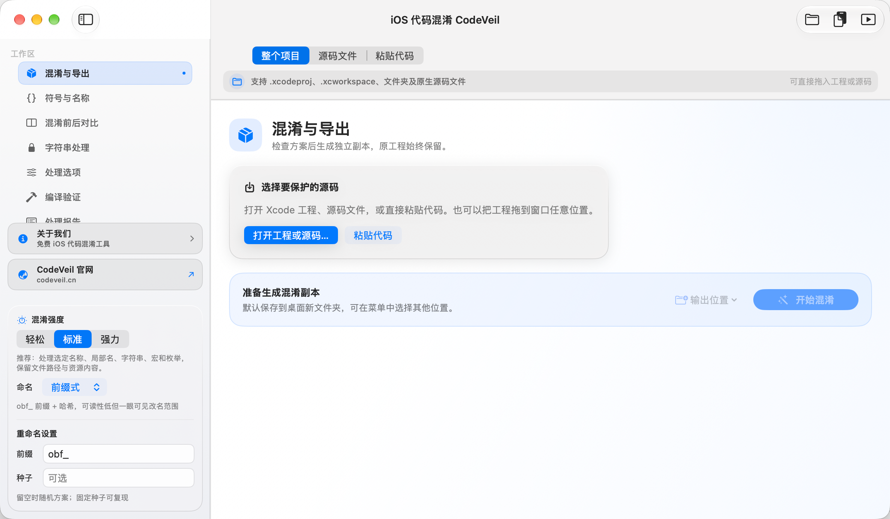
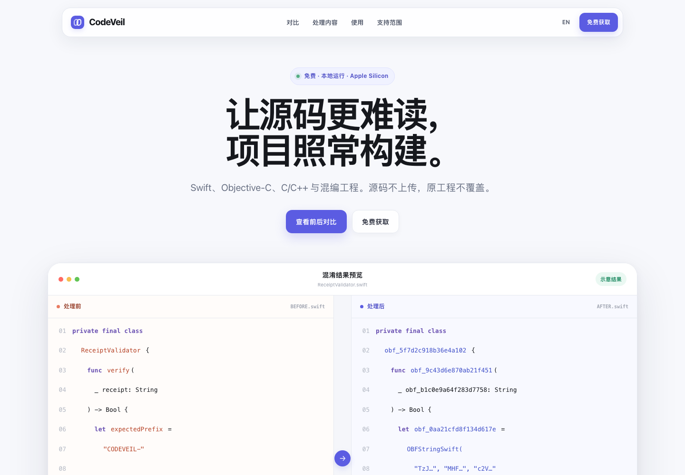

<p align="center">
  
</p>

<h1 align="center">CodeVeil</h1>

<p align="center"><strong>免费的 iOS 代码混淆工具 · 本地运行 · Apple 已公证</strong></p>

<p align="center">
  
  
  
  
  
</p>

<p align="center">
  <a href="https://codeveil.cn"><strong>官方网站</strong></a>
  ·
  <a href="https://codeveil.cn/downloads/CodeVeil-1.6.0-Apple-Silicon.dmg"><strong>免费下载 DMG</strong></a>
  ·
  <a href="https://github.com/Daji668/CodeVeil/releases"><strong>版本发布</strong></a>
  ·
  <a href="https://github.com/Daji668/CodeVeil/issues"><strong>问题反馈</strong></a>
</p>

---

**CodeVeil 是一款免费的 iOS 代码混淆工具，面向 Swift、Objective-C、Objective-C++、C、C++ 与混编 Xcode 工程。**

核心代码分析、混淆和导出在 Mac 本地运行，源码默认不上传，原工程不覆盖。正式 DMG 已完成 Developer ID 签名与 Apple 公证，当前支持 Apple Silicon 和 macOS 13 及以上版本。

> 本仓库用于发布正式版本、产品说明、更新记录与问题反馈。CodeVeil 免费使用，但当前并未开放源代码。

## 软件界面

<p align="center">
  
</p>

## 混淆前后对比

同一段 Swift 逻辑经过处理后，类型、方法、参数、局部变量和字符串会按安全规则转换。实际结果会根据跨语言引用、反射、系统 API、Interface Builder 和保留规则调整。

<p align="center">
  
</p>

<table>
  <tr>
    <th>处理前</th>
    <th>处理后</th>
  </tr>
  <tr>
    <td><pre><code class="language-swift">private final class ReceiptValidator {
    func verify(_ receipt: String) -&gt; Bool {
        let expectedPrefix = "CODEVEIL-"
        return receipt.hasPrefix(expectedPrefix)
    }
}</code></pre></td>
    <td><pre><code class="language-swift">private final class obf_5f7d2c918b36e4a102 {
    func obf_9c43d6e870ab21f451(
        _ obf_b1c0e9a64f283d7758: String
    ) -&gt; Bool {
        let obf_0aa21cfd8f134d617e =
            OBFStringSwift("TzJ…", "MHF…", "c2V…")
        return obf_b1c0e9a64f283d7758
            .hasPrefix(obf_0aa21cfd8f134d617e)
    }
}</code></pre></td>
  </tr>
</table>

## 面向 iOS 开发者的能力

- 识别 `.xcodeproj`、`.xcworkspace`、Swift Package、工程目录与独立源码文件
- 支持 Swift、Objective-C、Objective-C++、C、C++ 和混编项目
- 处理类、方法、属性、参数、局部变量、枚举、宏及相关引用
- 按保留规则保护系统 API、协议入口、动态调用与不确定符号
- 提供字符串保护、命名方案、符号映射、风险提示与处理报告
- 生成独立工程副本，不覆盖原始项目
- 在工程工作台中浏览源码、资源与工程配置
- 对混淆副本执行 Xcode 构建验证，并保留可诊断的构建日志
- 可选接入开发者自己的 AI 模型辅助分析错误；启用前会由开发者自行配置

## 使用方式

1. 拖入 Xcode 工程、Workspace、项目文件夹或源码文件。
2. 检查语言、Target、桥接关系、动态调用和风险项。
3. 选择混淆强度、命名方案和保留规则。
4. 生成独立副本并执行编译、测试和签名验证。

## 系统要求

| 项目 | 要求 |
|---|---|
| Mac 芯片 | Apple Silicon（M1、M2、M3、M4 及后续芯片） |
| macOS | macOS 13 或更高版本 |
| Intel Mac | 暂不支持 |
| 当前版本 | CodeVeil 1.6.0 |
| 分发状态 | Developer ID 签名、Apple 已公证、Gatekeeper 可验证 |

## 下载与安装

**[免费下载 CodeVeil 1.6.0（Apple Silicon）](https://codeveil.cn/downloads/CodeVeil-1.6.0-Apple-Silicon.dmg)**

1. 打开下载的 DMG。
2. 将 `CodeVeil.app` 拖入“应用程序”。
3. 从“应用程序”启动 CodeVeil。

正式 DMG 已通过 Apple 公证。首次启动时，macOS 仍可能显示标准的“此应用从互联网下载”确认，这是正常的 Gatekeeper 安全提示。Apple 公证不代表 Apple 对产品功能或安全效果作出背书。

## 文件校验

```text
CodeVeil-1.6.0-Apple-Silicon.dmg
SHA-256: 9f29d5ac4bd148fe85f992aa590382605698dfd7d8620841261c4fb9e9bb6baa
```

[下载官方 SHA-256 校验文件](https://codeveil.cn/downloads/CodeVeil-1.6.0-Apple-Silicon.dmg.sha256)

在终端中校验：

```bash
shasum -a 256 CodeVeil-1.6.0-Apple-Silicon.dmg
```

## 免费使用与产品边界

CodeVeil 作为面向 iOS 开发者的公益工具免费提供，不收取订阅费用。

免费不代表开源。本仓库不授予复制、修改、反编译、二次打包或冒名分发产品的权利。若后续调整授权范围，会在本仓库单独说明。

混淆用于提高静态阅读、批量改名和自动分析的成本，不等于代码绝对无法还原，也不承诺应用审核结果。请始终对生成副本执行完整的编译、测试、签名与发布验证。

## 隐私

默认的代码分析、混淆和导出在本地完成，源码不上传。若开发者主动配置第三方 AI 服务，所选代码、构建错误或日志可能会发送给对应模型提供商；发送范围取决于开发者的操作和该服务的隐私政策。

详见 [PRIVACY.md](PRIVACY.md)。

## 反馈

- 官网：[https://codeveil.cn](https://codeveil.cn)
- GitHub Issues：[提交问题](https://github.com/Daji668/CodeVeil/issues)
- QQ 群：`1135702470`
- 邮箱：`dajid4495@gmail.com`

反馈工程兼容问题时，建议提供 macOS 与 Xcode 版本、项目语言、依赖管理方式和已脱敏的关键错误。请勿提交 API Key、签名证书、Provisioning Profile、完整私有源码或未脱敏日志。

---

## English

**CodeVeil is a free, local and Apple-notarized iOS code obfuscation tool for Swift, Objective-C, Objective-C++, C, C++ and mixed-language Xcode projects.**

It helps increase source-code analysis cost while preserving project structure and build workflows. Core analysis, obfuscation and export run locally on macOS; source files are not uploaded by default and the original project is not overwritten.

Requirements: Apple Silicon and macOS 13 or later. Intel Macs are not currently supported.

CodeVeil is closed-source freeware. This repository hosts product documentation, releases, checksums and issue tracking; it does not publish the application source code.

[Official Website](https://codeveil.cn) · [Download DMG](https://codeveil.cn/downloads/CodeVeil-1.6.0-Apple-Silicon.dmg) · [Releases](https://github.com/Daji668/CodeVeil/releases)
